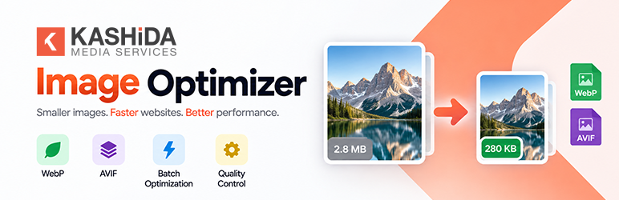
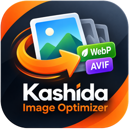
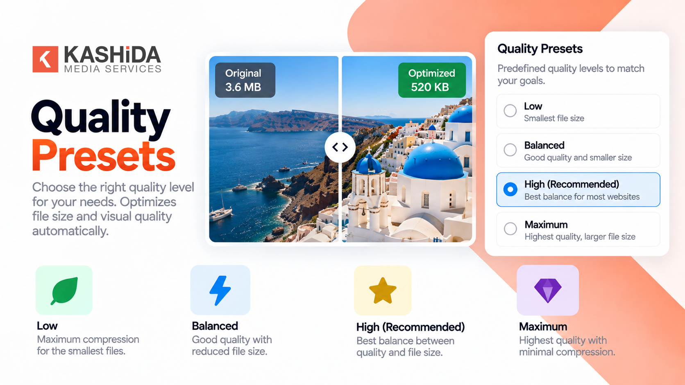
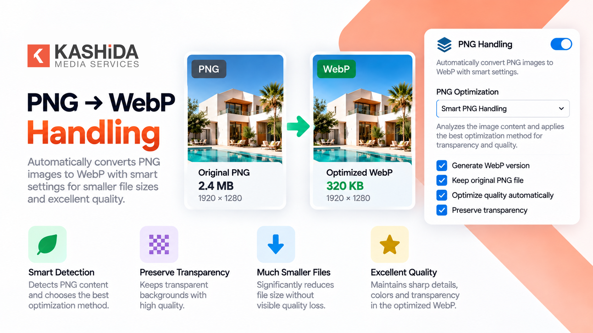
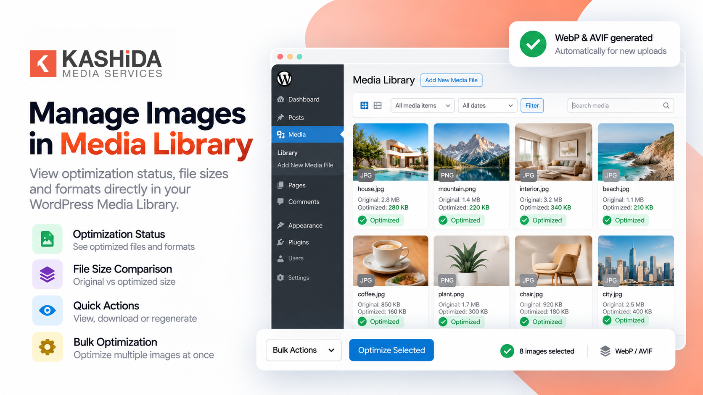
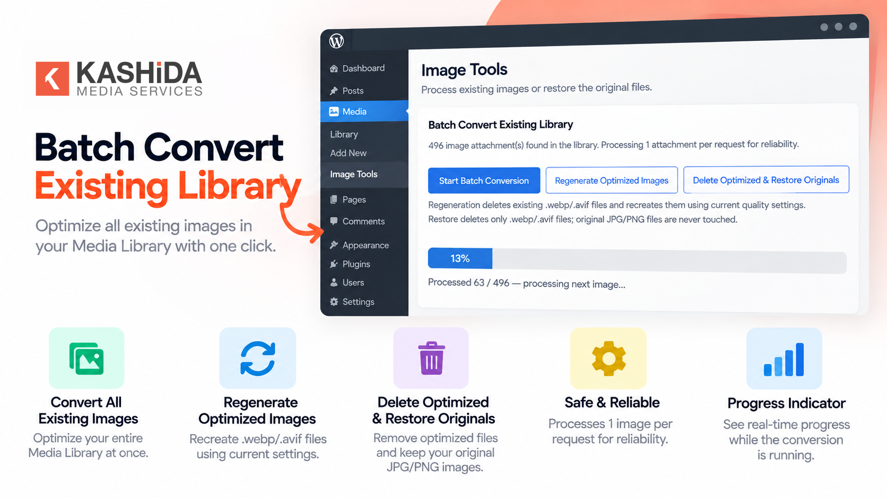
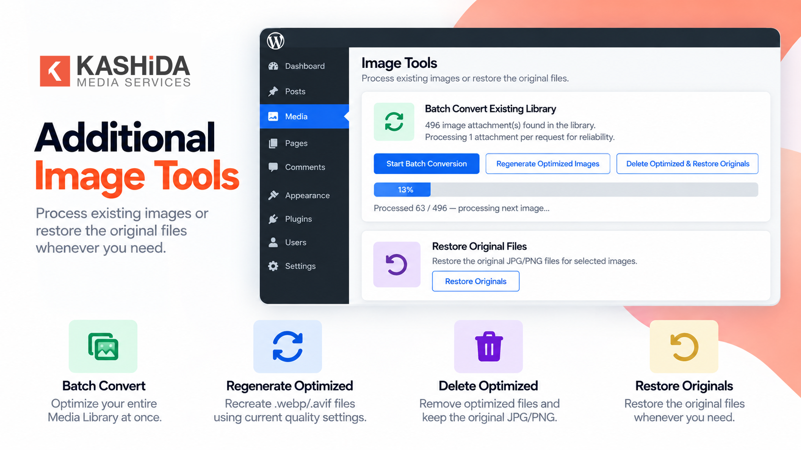
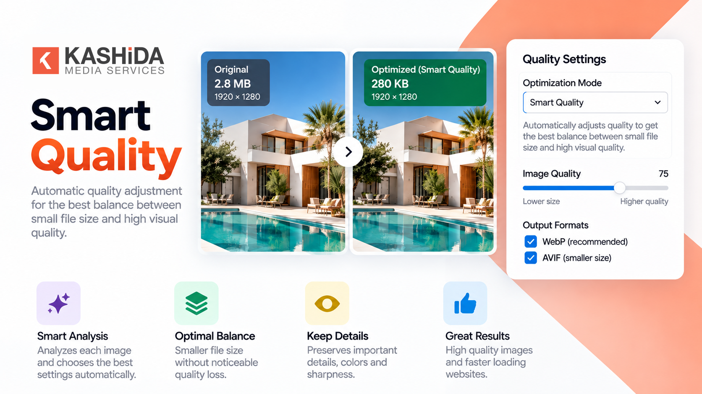

# Kashida Image Optimizer

  

  

  <strong>Smaller images, faster websites, better performance.</strong>

  
  
  
  

Kashida Image Optimizer is a lightweight WordPress image optimization plugin that automatically creates optimized **WebP and AVIF** versions of your images while keeping the original files untouched.

Optimize new uploads automatically or process your existing Media Library with batch conversion, re-optimization, and cleanup tools. Fine-tune WebP and AVIF quality settings, use Smart PNG Handling and Smart Content Detection, and choose the best optimized format for faster image delivery.

  <a href="https://github.com/mrwan-bg/kashida-image-optimizer/releases">
    <strong>Download Plugin</strong>
  </a>
  &nbsp; • &nbsp;
  <a href="https://github.com/mrwan-bg/kashida-image-optimizer/issues">
    <strong>Report an Issue</strong>
  </a>
  &nbsp; • &nbsp;
  <a href="https://kashida.ly/">
    <strong>Kashida Media Services</strong>
  </a>

---

## Features

- **Automatic Optimization** — Optimize eligible images when new files are uploaded.
- **WebP and AVIF Generation** — Generate modern image formats for optimized delivery.
- **Smart PNG Handling** — Handle PNG images with transparency support.
- **Smart Content Detection** — Detect image content to help optimize photos and graphics appropriately.
- **Separate Quality Controls** — Configure WebP and AVIF quality independently.
- **Quality Presets** — Select optimization settings for different needs.
- **Batch Conversion** — Process existing images in the WordPress Media Library.
- **Resumable Batch Processing** — Resume interrupted batches from the last saved checkpoint when the same browser and site are used.
- **Server-Block Diagnostics** — Show guidance for HTTP 403 and related request failures without repeatedly retrying blocked requests.
- **Re-optimization** — Re-process images using updated settings.
- **Media Library Integration** — View optimization status and access quick actions.
- **Original File Preservation** — Keep original images untouched.
- **Large Image Protection** — Reduce resource pressure when processing large images.
- **Orphan File Cleanup** — Clean up eligible leftover optimization files.
- **Local Processing** — Process images on your WordPress server without external optimization services.
- **Translation Support** — Includes Arabic `.po` and `.mo` files and a `.pot` template for preparing additional languages.
- **Multilingual Compatibility** — Supports multilingual workflows, including Polylang.

## Screenshots

Explore the plugin interface and features below.

### 1. Plugin Overview

### 2. Smart PNG Handling

### 3. Image Optimization

### 4. Quality Controls

### 5. Media Library Integration

### 6. Additional Features

---

## Installation

1. Download [Kashida Image Optimizer v5.1.35](https://github.com/mrwan-bg/kashida-image-optimizer/releases).
2. Log in to your WordPress dashboard.
3. Navigate to **Plugins → Add New Plugin**.
4. Click **Upload Plugin**.
5. Select `kashida-image-optimizer.zip`.
6. Click **Install Now**.
7. Click **Activate Plugin** after installation.
8. Open **Kashida Image Optimizer → Settings**.
9. Configure your image quality and optimization options.
10. Click **Save Settings**.

### Optimize New Uploads

Enable **Auto-convert new uploads** in the plugin settings to optimize eligible images automatically when they are uploaded.

### Optimize Existing Images

Use **Batch Convert Existing Library** to process images already stored in your WordPress Media Library.

### Re-optimize Images

Update your quality settings and use the re-optimization action to process eligible images again with the new configuration.

### Restore and Clean Up

Use the available restoration and cleanup tools according to their descriptions in the plugin interface. Original files are preserved by the plugin.

---

## Requirements

- **WordPress:** 5.5 or later
- **PHP:** 8.0 or later
- **Image Processing:** Compatible Imagick and/or GD capabilities

### WebP and AVIF Support

Output format availability depends on the capabilities of the installed image-processing library and the server environment. AVIF generation requires compatible server-side support.

For current WordPress environment recommendations, see the [official WordPress requirements](https://wordpress.org/about/requirements/).

---

## Plugin Information

| Property | Details |
|---|---|
| Plugin Name | Kashida Image Optimizer |
| Current Version | 5.1.35 |
| Requires WordPress | 5.5 or later |
| Tested up to | WordPress 7.1 |
| Requires PHP | 8.0 or later |
| License | GPL-2.0-or-later |
| Text Domain | `kashida-image-optimizer` |
| Supported Input Formats | JPG, JPEG, PNG |
| Optimized Output Formats | WebP, AVIF |
| Processing Location | Local WordPress server |
| Original Files | Preserved |
| External Optimization Services | None |
| Tracking / Telemetry | None |

---

## Privacy

Image processing takes place locally on your WordPress server. According to the supplied plugin specifications, the plugin does not use external image optimization services or tracking telemetry.

---

## License

Kashida Image Optimizer is licensed under **GPL-2.0-or-later**.

See the [LICENSE](LICENSE) file for the license text.

---

## Contributors and Developers

**Kashida Media Services**

Developer: **Mrwan elGobee**

- Website: [https://kashida.ly/](https://kashida.ly/)
- Behance: [Mrwan elGobee](https://www.behance.net/Mrwan_elgobee)
- GitHub Repository: [kashida-image-optimizer](https://github.com/mrwan-bg/kashida-image-optimizer)

---

## Support and Bug Reports

For bug reports, feature requests, and technical discussions, visit the [GitHub Issues](https://github.com/mrwan-bg/kashida-image-optimizer/issues) page.

Before submitting an issue, include your WordPress version, PHP version, image-processing library, and a clear description of the problem.

---

## Releases

Download available ZIP packages from [GitHub Releases](https://github.com/mrwan-bg/kashida-image-optimizer/releases). The v5.1.35 package still needs to be attached to its GitHub release.

**Current documented version:** `5.1.35`

---

  <strong>Kashida Image Optimizer</strong> 
  Smaller images. Faster websites. Better performance.

  Developed by <a href="https://kashida.ly/">Kashida Media Services</a>

